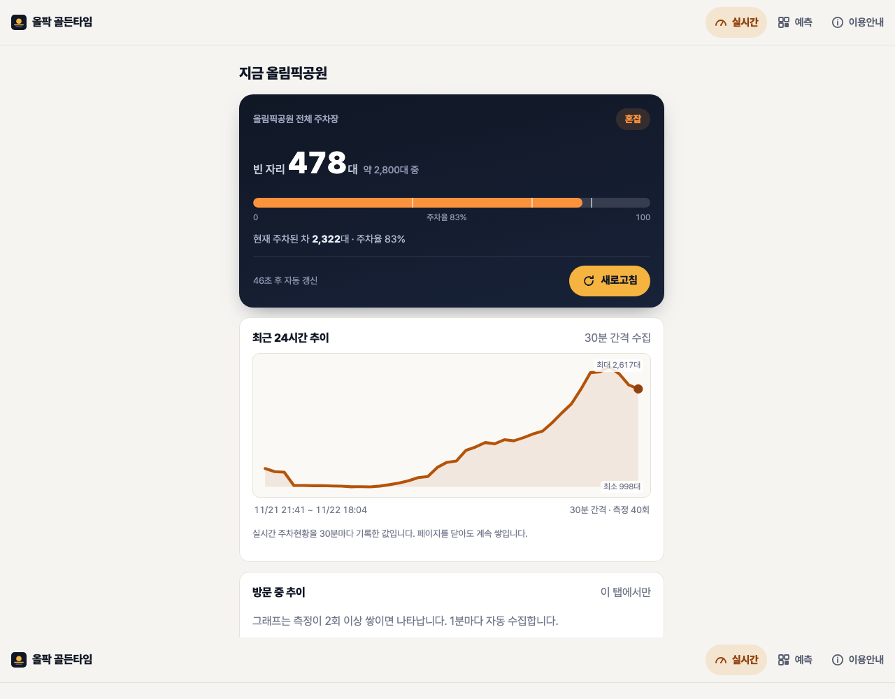

# 올팍 골든타임

올림픽공원 전체 주차장의 실시간 혼잡과 빈 자리를 보여 주고, 과거 실측으로 가장 한산한
시간대(골든타임)를 알려주는 웹 서비스. KSPONCO 공공데이터 활용 경진대회 아이템 1 출품작.

- 서비스: <https://developjik.github.io/ksponco-goldentime/>
- 기술: Vite 5 · React 18 · TypeScript, GitHub Actions로 GitHub Pages 배포




## 기능

- **실시간**: 한국체육산업개발(주) 공개 실시간 주차현황 API를 60초 간격으로 조회해 빈 자리
  수(약 2,800대 기준)와 주차율·혼잡 단계를 계기판 형태로 표시.
- **방문 중 추이**: 세션에서 수집한 주차대수의 스파크라인.
- **골든타임 예측·히트맵**: 공공데이터포털 시간별 연계 데이터(2025년)를 요일×시간 평균
  주차율로 집산해 히트맵과 요일별 골든타임을 제공(집산 결과는 `public/data/pattern-2025.json`).
- **어느 문으로 들어올까?**: 공공데이터포털 입출차 전체구역 데이터(2025년 약 240만 건)를
  게이트×요일×시간 입차 건수·평균 체류시간으로 집산해 게이트별 유입 비중·피크 시간을
  제공(집산 결과는 `public/data/gates-2025.json`).
- **예측 정확도(백테스트)**: 30분 수집 실측을 KST 요일×시간 칸으로 묶어 2025년 패턴 예측과
  비교(운영시간 06~21시, 주차율 MAE·편향·Spearman 순위상관·요일별 골든타임 적중). 예측 화면에
  정확도 카드와 예측(선) vs 실측(점) 차트, 표본 수 n을 표시하고, 칸당 서로 다른 30분 수집 2회 미만은 회색,
  채점 칸 8칸 미만이면 '검증 중'으로 둔다. `npm run backtest`(또는 `-- --json`)가 MAE·n과
  제출 문서용 한 줄 요약을 출력한다.
- **최근 24시간 추이**: 30분마다 자동 수집한 주차대수 기록(`public/data/realtime-history.json`)으로
  최근 하루 곡선을 홈에 표시. 페이지를 닫아도 계속 쌓인다.

## 데이터

| 데이터 | 출처 |
| --- | --- |
| 실시간 전체 주차대수 | 한국체육산업개발(주) 올림픽공원 실시간 주차현황 공개 API |
| 전체 수용 능력 약 2,800대 | 올림픽공원 홈페이지 자주하는 질문 |
| 요일×시간 패턴 | 공공데이터포털 한국체육산업개발주식회사_실시간 주차현황 연계(API_CPM_009) |
| 게이트별 유입·체류 | 공공데이터포털 한국체육산업개발주식회사_실시간 주차현황 입출차 전체구역(API_CPM_008) |

혼잡 단계 경계(여유<40≤보통<70≤혼잡<85≤매우 혼잡, 주차율 %)는 이 서비스의 자체 기준.

## 개발

```bash
npm install
npm test        # 단위테스트(vitest)
npm run dev     # 개발 서버(5178)
npm run build   # tsc -b && vite build
npm run backtest # 예측 백테스트(MAE·n·한 줄 요약)
npm run preview # 프로덕션 프리뷰(4178)
```

## 자동화(GitHub Actions)

- `deploy.yml` — main push·데이터 워크플로 완료 시 Pages 배포.
- `refresh-history.yml` — 30분마다 공개 실시간 API를 호출해 `public/data/realtime-history.json`에
  측정값 축적(키 불필요). 홈 '최근 24시간 추이' 패널의 데이터.
- `aggregate-2025.yml` — 수동 실행. `KSPONCO_LINK_API_KEY` 시크릿으로 연계 데이터를 전수
  수집·집산해 `public/data/pattern-2025.json` 갱신(원문 저장 없음, 집산물만).
- `aggregate-008.yml` — 수동 실행. `KSPONCO_ENTRY_API_KEY` 시크릿으로 입출차 약 240만 건을
  전수 수집해 게이트×요일×시간으로 집산, `public/data/gates-2025.json` 갱신(원문 저장 없음,
  집산물만). 잡 제한(5시간)을 넘지 않도록 `time_budget_minutes`(기본 260분)에 멈추고
  체크포인트(`data/gates-2025.checkpoint.json`, 완료 페이지·집산 합만)를 커밋한 뒤 같은
  워크플로를 다시 디스패치해 이어받는다(`auto_continue`·`chain_left`). 요청 시작 간격 2.5초를
  지키며 `concurrency`개(기본 4)를 동시에 띄운다. `dry_run_pages`(예: 5)로 커밋 없이 누적 건수만
  확인할 수 있고, `reset`은 체크포인트를 버리고 처음부터 수집한다. 로컬 드라이런:
  `DRY_RUN_PAGES=5 KSPONCO_ENTRY_API_KEY=… node scripts/aggregate-008.mjs`.

## 라이선스

이 저장소의 코드는 MIT 라이선스입니다 — 자세한 내용은 [LICENSE](LICENSE)를 참고하세요.
데이터는 각 출처(한국체육산업개발(주) 실시간 주차현황 · 공공데이터포털 · 올림픽공원 홈페이지)의 이용 정책을 따릅니다.

### 브라우저 주차 요청 제한시간 (DEV-131)

실시간 조회는 재시도 1회를 포함해 최대 10초로 제한합니다. 응답 본문 대기에도 적용하며 시간 초과 뒤 수동·자동 갱신이 다시 가능합니다. 화면을 떠나면 해당 요청을 취소하고 오래된 요청의 결과가 새 화면 상태를 덮어쓰지 못하게 합니다. 마지막 성공 값이 있으면 실패 안내와 마지막 성공 시각을 함께 표시합니다. PR의 Check 워크플로는 테스트·빌드만 수행하며 배포하지 않습니다.
